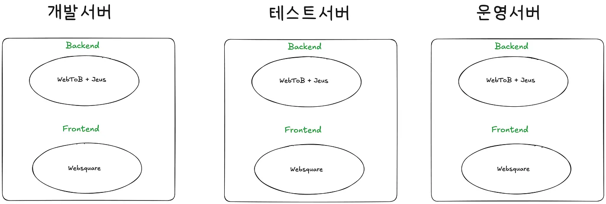
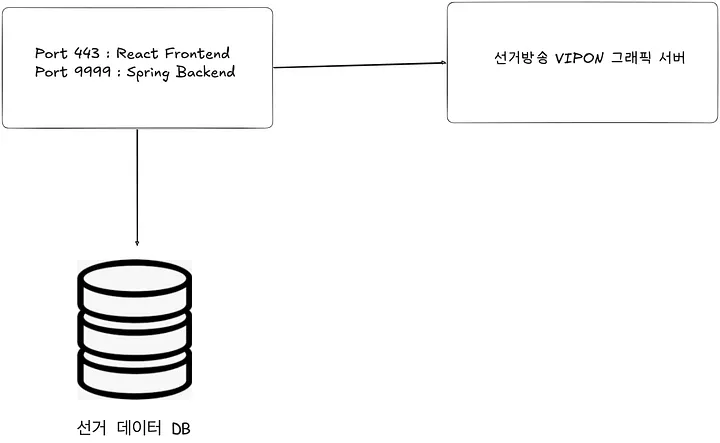
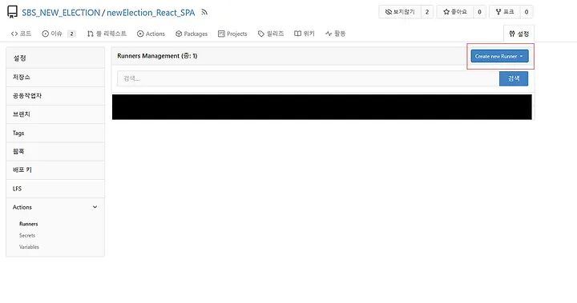
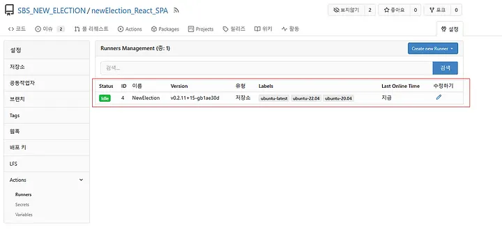
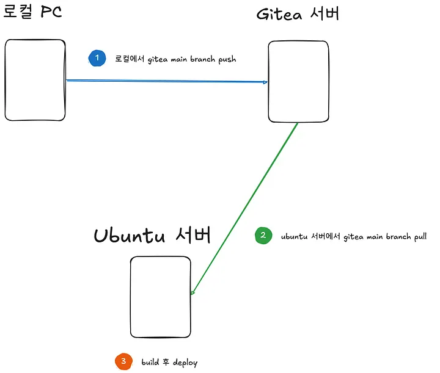
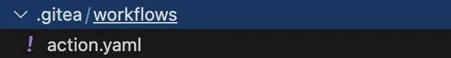
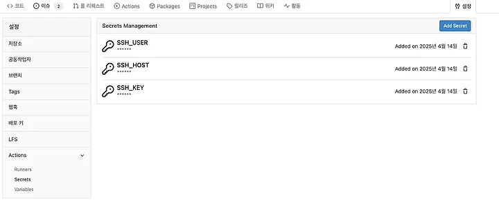
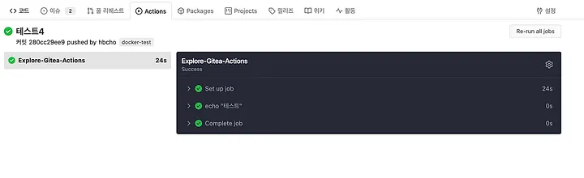

우리 팀은 웹 서비스를 구축한 20년전부터 지금까지 티맥스의 [JEUS](https://www.tmaxsoft.com/kr/solution/view?solutionSeq=2)를 사용하고 있다.

JEUS로 API(우리는 서비스라고 부른다)를 개발하기 위해서는 C로 sqc를 개발하고 해당 서비스를 컴파일한 후, 개발/테스트/운영 서버에 배포한다.

이처럼 티맥스 컴파일러와 커맨드에 많이 의존하고 있다.

하지만 우리팀 영보이들을 더 열받게 하는 건 바로 SVN이다.

이로인해 작금의 사태에 분노를 느낀 나의 (과거)맞사수 남선배는 신입 시절에 git 도입을 강력하게 주장했다.

우리가 파악하기에는 SVN 자체가 문제라기보다는 현재 SVN이 구축되어 있는 환경이 제일 문제다.

현재 서버 환경은 개발서버와 테스트서버 그리고 운영서버로 구성되어있다. 개발 서버는 현업 직원들의 요청 사항을 반영해서 우리팀에서 기능을 개발하는 목적이고, 이후 개발 서버 코드를 테스트서버에 반영한 후 현업 사용자들이 테스트 서버에서 기능 테스트를 진행한다. 그리고 테스트를 통과하면 운영 서버에 배포한다.



우리가 가장 어려움을 겪고 있는 부분은 ‘**개발 생산성**’이다.

현재는 각각의 서버만이 제품 라이센스를 가지고 있다.


본디 Best는 개발자가 로컬에서 개발하고 해당 산출물을 개발 서버에 반영해서 확인/검토가 가능해야한다.


그러기 위해서는 개발자마다 제품 라이센스를 가지고 있어야 하는데, 회사를 다니다보면 여러가지 상황때문에 그렇지 않은 경우가 있다.

그 결과, 로컬에서 확인을 하지 못한 채 마치 개발 서버 코드 베이스를 각자가 로컬처럼 사용하게 된다.


개발 서버 내에서 API 수정 -> 개발 서버 내 해당 코드 수정 -> SVN Commit


개발 서버 내에서 HTML 수정 -> 개발 서버 내 해당 코드 수정 -> SVN Commit

더더욱 프론트엔드 개발자인 나는 이 과정이 너무너도 불편했다.(지금도 불편함)
버튼의 색깔을 바꾸려고 해도, 개발 서버의 코드 베이스를 직접 수정한 후 개발 웹서버를 통해 봐야하는것이…

그런데 아래와 같은 궁금증이 생길수도 있다.


Q. 개발 서버의 프론트 코드를 로컬에서 pull해서 개발하면 되지 않나요?

A. 아쉽지만, 현재 웹서버는 웹스퀘어 엔진을 사용하고 있습니다. 로컬에 웹스퀘어 엔진이 없다면, 웹스퀘어로 작성된 정적파일을 당신은 렌더링을 할 수 없을걸요…?(아마도) 여튼 안됩니다.

개발 서버는 개발자들의 편하게 기능을 추가하고 간단하게 테스트하기 위한 서버인데, 위의 구조에서는 각자의 로컬 코드베이스로 사용되면서 svn commit도 관리가 되기가 어렵다.

하물며 단순히 버튼 색깔을 바꾸는것도 commit을 해야하므로…

숱한 어려움이 있었지만 어찌되었든 남선배는 git으로의 대전환을 위해 사내에 gitea를 구축하셨고, 현재는 svn과 git을 공존해서 사용하고 있다.

---
우리 팀은 선거가 있는 해에는 선거방송 시스템 개발을 담당한다.
(선거방송 시스템에 대해서는 다른 포스팅으로 연재하겠습니다)

이번 2025년 대통령 선거는 백엔드/프론트엔드를 둘다 gitea를 사용해서 프로젝트를 진행중이다.

svn을 벗어나서 gitea를 사용하는것만으로도 너무 행복하지만, 이왕 하는김에 github action과 같은 CI/CD를 구축하고자 gitea에서도 방법을 찾아봤다.




우리 팀은 선거방송 송출부서에게 (1) 프론트와 (2) 백엔드 서비스를 제공한다.

내가 중점적으로 맡은 업무는 프론트 파트로, 방송 송출/관리 페이지와 백엔드 데이터 호출 기능을 제공한다.

원래는 로컬에서 개발한 후,

(1) gitea front repo로 push

(2) 서버에서 git pull and build

(3) deploy

과정을 거치고 있는데, 이 과정도 직접 손으로 그만하고 action을 도입하기 위해 나의 고생길이 시작되었다.

---
제일 먼저 필요한 세팅은 self-hosted runner 세팅이 필요하다.
runner는 Gitea Action에서 workflow 작업을 진행할 주체를 의미하고, gitea는 기본적으로 클라우드 머신을 제공하지 않기 때문에 로컬 머신으로 환경을 진행했다.
(쉽게 말하면, workflow 작업을 진행할 머신을 고르는 작업)

우리 팀은 Spring과 React 서버가 돌아가는 동일한 ubuntu 머신에 docker-compose로 작업을 진행하기로 결정했다.
(아래 구체적인 프로세스는 공식 홈페이지를 follow)(https://docs.gitea.com/usage/actions/act-runner)


1. 공식 문서에 Start the runner using docker compose 파트를 참고해서 docker-compose.yaml을 작성한다.(Binary로 install해도 됨)
```
version: "3.8"
services:
  act_runner:
    image: gitea/act_runner:0.2.11
    container_name: new_election_react
    environment:
      CONFIG_FILE: /config.yaml
      GITEA_INSTANCE_URL: '머신 IP'
      GITEA_RUNNER_REGISTRATION_TOKEN: '토큰'
      GITEA_RUNNER_NAME: "new_election_react"
      #GITEA_RUNNER_LABELS: ubuntu-latest:docker
    volumes:
      - ~/act-runner/data:/data
      - ~/act-runner/cache:/root/.cache
      - ./config.yaml:/config.yaml
      - /var/run/docker.sock:/var/run/docker.sock
```
2. 머신 IP에는 현재 gitea IP:Port를 입력하고, 토큰은 해당 프로젝트 -> 설정 -> Actions -> Runners -> Create New Runner를 눌러서 나온 토큰값을 입력한다.




3. config 파일의 경우 config 파일이 특정되지 않으면 default config를 사용하고, default를 사용해도 무방하다.
단 config 파일을 직접 수정할 예정이라면 act_runner_binary 파일을 다운로드 받아서 아래 커맨드로 config 파일을 만들 수 있다.

```
./act_runner generate-config

```
4. 위 docker-compose.yaml로 docker를 실행하면

```
docker-compose up d

```
아래 사진처럼 runner가 보인다!(원래는 안보임)




---
내가 구상하는 CI/CD 구조는 아래와 같다.



```
1. 로컬에서 열심히 개발 한 후 gitea main branch로 push
2. gitea act runner가 내가 작성한 workflow 수행
---- 아래는 workflow 의사 코드 ----
2-a. react project 디렉토리 이동
2-b. main branch pull
--------------------------------------
3. build
4. deploy
```

이제 열심히 세팅한 runner가 일을 하도록 작업 지시를 하면 된다. 즉 workflow를 작성해야한다. 공식문서에 아래와 같은 sample.yaml 예시를 알려준다.

```
name: Gitea Actions Demo
run-name: ${{ gitea.actor }} is testing out Gitea Actions 🚀
on: [push]

jobs:
  Explore-Gitea-Actions:
    runs-on: ubuntu-latest
    steps:
      - run: echo "🎉 The job was automatically triggered by a ${{ gitea.event_name }} event."
      - run: echo "🐧 This job is now running on a ${{ runner.os }} server hosted by Gitea!"
      - run: echo "🔎 The name of your branch is ${{ gitea.ref }} and your repository is ${{ gitea.repository }}."
      - name: Check out repository code
        uses: actions/checkout@v4
      - run: echo "💡 The ${{ gitea.repository }} repository has been cloned to the runner."
      - run: echo "🖥️ The workflow is now ready to test your code on the runner."
      - name: List files in the repository
        run: |
          ls ${{ gitea.workspace }}
      - run: echo "🍏 This job's status is ${{ job.status }}."
```


디테일한 작업을 위해서는 workflow syntax와 작성 방법을 알아야하지만, 뭐든지 해보면서 배우면 된다.

우선 yaml 파일은 프로젝트 디렉토리에서 ./gitea/workflow/*.yaml 에 위치해야한다.(아래처럼 action.yaml을 세팅함)





아래는 내가 이번 프로젝트에서 사용한 action.yaml이다.


* on : workflow를 실행시킬 이벤트를 설정한다
주로 push를 많이 사용하는데, 예를들면 main branch에 push가 발생하면 workflow가 실행된다.
push 말고 pull_request, fork, create, delete 등 모두 있다.
* jobs : workflow의 작업 단위
workflow는 하나 이상의 job으로 구성된다. 각각의 job은 runs-on에 명시된 runner environment에서 실행된다.
(여기서는 ubuntu-latest)
* steps : job의 sequence of tasks
용어가 생소하지만, 적혀있는 task 목록이라고 생각하면 된다.

```
name: newElectionReact
run-name: newElectionReact
on:
  push:
    branches:
      - main
jobs:
  build-and-deploy:
    runs-on: ubuntu-latest
    steps:
      - name: Checkout code
        uses: actions/checkout@v3

      - name: 배포
        uses: appleboy/ssh-action@master
        with:
          host: ${{ secrets.SSH_HOST }}
          username: ${{ secrets.SSH_USER }}
          key: ${{ secrets.SSH_KEY }}
          script: |
            cd /election/
            git pull origin main
            npm run build
            echo "배포 완료"
```


위 action.yaml은


(1) main branch에 push 이벤트가 발생하면


(2) build-and-deploy 라는 이름을 가진 job이 실행된다.

이제 첫번째 task를 살펴보자.
Checkout code라는 이름으로 actions/checkout@v3를 use한다.

action은 기본적으로 재사용가능한(reusable) 코드 단위이다. 그래서 같은 디렉토리에 있는 다른 workflow(yaml)이나 public repo, pulished docker image에 있는 action을 여기에서도 사용할 수 있다.

여기서 actions/checkout 이라는 ‘action’은 workflow가 실행되는 environment에 repo의 복사본을 만들어준다.

이것이 필요한 이유는 기본적으로 runner는 코드 저장소에 접근할 수 없기 때문이다.
runner가 코드 저장소에 접근할 수 없다면 어떻게 코드를 빌드하고, 배포할 수 있을까?
그래서 checkout을 통해 원격저장소에 있는 코드의 복사본을 먼저 내려받는다.

두번째 task를 살펴보자.
‘배포’라는 이름으로 appleboy/ssh-action@master action을 use한다.

먼저 with 구문을 설명하자면.
with는 workflow에서 action에 인자를 넘길 때 사용한다. 각 input parameter는 key-value pair로 제공되고, runner에게 환경변수로 제공된다. (즉, action에게 host, username, key 라는 환경변수를 제공한다)

그리고 각각의 key는 보안을 위해서 gitea에서 제공하는 secrets를 사용했다.
(해당 프로젝트 > 설정 > Actions> Secrets > Add Secret을 통해 만들 수 있음)




3개의 환경변수들을 이용해서 appleboy/ssh-action@master action 에서 사용한다.
ssh-action은 내가 제공한 host 환경변수와 key 환경 변수를 이용해서 ssh로 원격 접속을 한다.
그래서 두번째 task는 요약하면, ssh action을 통해 (1) host에 ssh로 원격 접속 후 (2) script를 실행한다.

만약 self-hosted runner를 ubuntu 머신에서 docker-container로 실행하지 않고 binary로 실행했다면 같은 머신이기 때문에 바로 script 작업을 할 수 있다.

하지만 docker-container의 경우 container에서 ubuntu 머신으로 ssh 접속을 해야한다. 그래서 마지막으로 ssh 세팅이 필요하다


---
docker-container가 Ubuntu(HOST)로 접속을 하기 위해서는 아래의 과정이 필요하다.

(1) container 내부 private ssh key 생성
(2) host에서 public key 등록
(3) workflow secret key 설정

먼저 container에서 ssh-keygen을 이용해서 key를 생성한다.

```
ssh-keygen -f /root/.ssh/election // -f는 파일 경로를 지정하는 명령어

```

/root/.ssh/ 디렉토리에

(1) election (private)
(2) election.pub (public)
2개의 키 쌍이 생성된다.

이제 호스트에서 election,pub 공개키를 등록해야한다.
container에서 public key의 내용을 복사한 후 (vi로 열어서 확인해도 된다)


```
cat /root/.ssh/election.pub
```


ubuntu에서 ~/.ssh/authorized_keys에 등록한 후, 파일 권한을 600으로 rw — — — — 설정한다.

```
(pub key content) >> ~/.ssh/authorized_keys 
chmod 600 ~/.ssh/authorized_keys
```


마지막으로 ssh-action에게 환경변수를 제공할 때 SSH_KEY라는 key-value를 만들었는데, 이 때 value에 container의 election private key 내용을 적어주면 된다.

테스트로 아래와 같이 docker container에서 host로 ssh 접속을 시도할 수 있다.


```
ssh sbs@1.1.1.1 // (ip는 보안상 예시)
Welcome to Ubuntu 22.04.5 LTS (GNU/Linux 5.15.0-134-generic x86_64)
 * Documentation:  https://help.ubuntu.com
 * Management:     https://landscape.canonical.com
 * Support:        https://ubuntu.com/pro
 System information as of 2025. 05. 02. (금) 08:44:39 KST
  System load:  0.0                Processes:             257
  Usage of /:   21.2% of 97.87GB   Users logged in:       1
  Memory usage: 13%                IPv4 address for ens3: 10.10.16.147
  Swap usage:   0%
 * Strictly confined Kubernetes makes edge and IoT secure. Learn how MicroK8s
   just raised the bar for easy, resilient and secure K8s cluster deployment.
   https://ubuntu.com/engage/secure-kubernetes-at-the-edge
Expanded Security Maintenance for Applications is not enabled.
45 updates can be applied immediately.
To see these additional updates run: apt list --upgradable
12 additional security updates can be applied with ESM Apps.
Learn more about enabling ESM Apps service at https://ubuntu.com/esm
*** System restart required ***
Last login: Fri Apr 25 08:36:09 2025 from 10.10.123.31
sbs@ubuntuTest:~$ // 이렇게 ubuntuTest에 접속성공!
```


ssh 접속까지 잘 되는것을 확인하고 로컬에서 테스트로 main branch로 push를 하면 아래와 같이 Actions 탭이 활성화 된 후 workflow가 진행되는것을 볼 수 있다!





실제로 현재 사용하고 있는 action은 포스팅한 내용보다 훨씬 task가 많다.(테스트 코드, 빌드, 배포 등)
생각보다 규모가 큰 프로젝트에 바로 적용하는것이 부담스러웠지만, 성공적으로 잘 마무리되었다.
