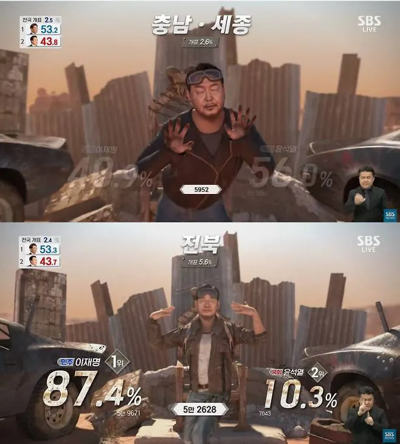
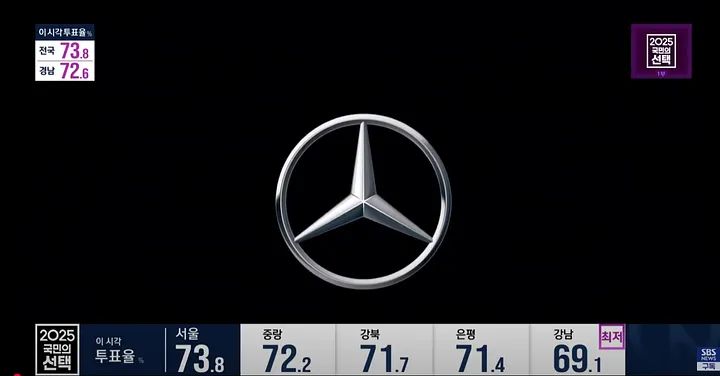
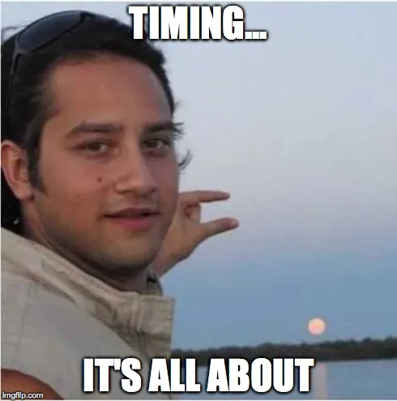

선거(대선, 총선, 지선…)가 있는 해에는 SBS 선거방송 프로젝트에 참여한다.

처음에는 우리 팀이 선거랑 무슨 상관이지? 싶었다,
(다른 팀들도 우리팀이 뭐하는 지 잘 모른다)

우리팀은 선거방송에서 데이터의 시작과 끝을 맡고 있다.
데이터가 생성되고, 가공되고, 화면에 나오기까지 모든 데이터의 흐름을 우리가 책임진다.

위에 보이는 방송 화면에 나오든 모든 데이터(득표율, 개표율, 순위, 후보, 지역 등)를 우리팀이 방송 화면 장비로 전달한다.

선거방송 시스템은 크게 VIPON 파트와 데이터 파트로 나눌 수 있다.
VIPON 파트는 방송화면에 송출되는 비디오/그래픽을 담당하고, 여러분들이 TV로 보는 모든 그래픽을 VIPON이 담당한다.

우리팀은 데이터 파트를 담당하며, 이 데이터 파트는 다시 세가지 역할로 나눈다.

**첫번째는 데이터베이스 파트**

선거마다 달라지는 데이터 프로토콜에 맞춰 데이터베이스를 설계하고 운영하는 역할을 한다. SBS 선거방송용 데이터베이스뿐만 아니라, 지역 민영방송에 사용할 데이터베이스도 함께 구축한다.

**두번째는 백엔드 파트**

투표율, 개표율, 개표 현황, 출구조사 순위, 지역별 후보 순위 등 다양한 바이폰(VIPON) 화면에서 필요한 데이터를 제공하기 위해 API를 설계하고 제공한다.

새롭고 창의적인 화면 포맷에 맞게 데이터를 빠르고 안정적으로 전달하는것이 핵심이다.

**마지막으로 프론트엔드 파트**

프론트엔드 파트는 선거 방송 당일, 방송 부조정실에서 바이폰을 운영하는 담당자가 사용할 프로그램을 개발한다.
담당자는 이 프로그램을 통해 TV 화면에 송출될 바이폰 메뉴를 검색하고, 해당 바이폰에 들어갈 데이터 값이 올바르게 출력되는 지 확인한 후, ONAIR 버튼을 눌러 방송장비로 시그널과 데이터를 전송한다.

---
많은 개발자들은 수많은 사람들이 직접 사용하는 서비스를 만드는 경험을 꿈꾼다.
일명 ‘대국민 서비스’라고 불릴 만한 규모의 프로젝트는 개발자로서 큰 도전이자 보람이기도 하다. 이러한 측면에서 선거방송 프로젝트는 우리 팀에게 매해 엄청난 도전이다.

우리가 가공한 데이터가 수많은 국민들에게 실시간으로 송출되는 그 순간은 설레기도 하지만 식은 땀이 흐르고, 가끔 온몸이 긴장으로 굳어지기도 한다.

선거방송 프로젝트 개발은 보통 본투표일 기준 2~3달전에 시작한다.
본격적으로 개발하기전에 백엔드 팀에서는 먼저 확인해야하는 것들이 있다.

선거방송은 매번 반복되는 이벤트같지만, 사실 매번 다르다.
후보, 정당, 행정구역이 바뀌기도 하고, 때때로 어떤 선거는 조기선거로 열리기도 한다.그래서 프로젝트 개발 전, 기초 데이터를 하나하나 꼼꼼하게 점검한다.

* 시도/구군 단위 코드가 변경되지 않았는지

행정구역 개편이나 통폐합으로 인해 시도 코드가 변경될 수 있다. 그러므로 예전 선거와 비교해서 변경된 사항이 있는 지 확인한다.
* 후보자 기호가 중복되거나 누락된 건 없는지

화면에 2번 후보가 두명이라거나, 3번 후보가 사라져있다면…? 실시간으로 방송사고로 직행한다.
* 정당코드와 정당명이 올바르게 매핑되어 있는지

A당 후보가 당일 방송에 B당 후보로 나온다면…? 그날 밤 SBS 선거방송은 매우 뜨거워진다…

이런 점들이 사소해 보일수도 있지만 사소한 실수가 수백, 수천만이 보는 방송에 치명적인 오류로 이어진다. 실제로 후보 이름 옆에 엉뚱한 정당이 나올뻔한 적이 있었다.
(진짜 회사 짤릴 뻔 )

그리고 선거 당일 D-DAY, 우리팀은 오전 방송 시작 2시간전(4AM)부터 전쟁터로 출근한다.

**(1) 투표율 체크**

오전 6시를 시작으로 선관위로부터 투표 데이터가 들어온다. 이후 매시각 정시(정확히는 그보다 조금 전)마다 각 시도/구군에서 투표데이터가 꾸준히 들어온다.

시도별/구군별로 모든 투표 데이터가 잘 들어왔는지, 누락없이 집계가 되는지 매번 빠르게 확인하고 누락시에는 바이폰 담당자에게 연락해서 바이폰을 잠시 홀드하고 상황을 해결한다.

이걸 놓친다면, 순간적으로 전국,시도별 투표율이 틀어지고 그 오차가 생방송으로 나간다.

**(2) 출구조사 수신 및 준비**

저녁 6시 투표 종료를 앞둔 시점에 출구조사 기관에서 출구조사 결과 데이터가 도착한다. 이를 받는 즉시, 데이터베이스 파트 담당자는 해당 데이터를 내부 포맷에 맞게 정리한 뒤, 출구조사 테이블에 정리한다.

그리고 백엔드팀과 프론트팀은 몇 분 내로 백엔드 API 체크 → 프론트 API 연동 체크를 끝내야한다. 선거 당일 가장 촉박하게 진행되는 순간으로, 절대 틀리면 안되는 순간이다.

**(3) 개표 진행 상황 실시간 분석**

개표가 시작되면, 우리가 만든 시스템은 각 선거구별 개표 현황을 실시간으로 분석한다.
몇 표까지 개표되었는지, 몇 퍼센트가 진행되었는지, 후보 중 누가 앞서고 있는지.

특히 개표 초반에는 미개표 선거구를 집중적으로 체크한다. ‘미개표’가 표시되는 바이폰 화면도 있기 때문에 ‘미개표’ 필드가 제대로 전달되는지 중점적으로 확인한다.

그리고 SBS 자체 유확당 알고리즘으로 유력 → 확실 → 당선 판단을 실시간으로 업데이트한다. 이 알고리즘은 단순한 득표율 비교가 아니라 개표 추세, 잔여 투표 수, 표 차이를 고려한 정교한 로직이라고 한다. (사실 나는 잘 모른다)

하지만 후보 옆에 ‘당선’이라는 두 글자가 잘못 나가는 대재앙이 발생할 것을 대비해서 항상 사람 눈으로 한번 더 크로스체크를 하고 방송에 보낸다.

---

앞서 설명했듯, 우리팀은 선거방송 당일 바이폰 운영을 위한 프론트엔드를 제공한다.
운영자는 이 프로그램에서 곧 방송에 나갈 바이폰을 검색하고, 해당 화면에 들어갈 데이터가 정확히 출력되는지 먼저 확인한다.
예를 들어 ‘전국 투표율’ 바이폰이라면 [전국 투표율 : 13.4%]처럼 데이터 형식이 올바른지, 실제 값이 잘 들어와 있는지를 체크한다.

그리고 프로그램에 있는 ONAIR 버튼을 누르면 바이폰 화면이 시작된다.
(실제로는 프론트엔드에서 TCP를 통해 바이폰 장비로 시그널과 데이터가 전달)

바이폰 운영자는 선거 방송 당일에 부조정실에 앉아있고, PC에서 프론트엔드 프로그램에 접속한 후 다음 화면을 준비하며 PD님의 콜에 맞춰 ONAIR 버튼을 누른다.

이 버튼 하나로, API에서 받아온 데이터가 바이폰 장비로 전송되고, 즉시 시청자들이 보는 TV 화면에 나타나게 된다.

**그래서 타이밍이 정말 중요하다.**

너무 빨리 누르면 → 아나운서 멘트와 싱크가 맞지 않고, 먼저 그래픽이 보인다.

너무 늦게 누르면 → 멘트는 나갔는데, 화면에는 아직 이전 그래픽이…(방송사고)

물론 이 부분은 운영자들의 영역이라 우리팀이 다루지는 않는다.
하지만 실수로 짧은 시간에 버튼을 여러번 누르는 것을 방지하기 위해 프론트엔드 개발 시 throttling을 구현한다.

바이폰 운영자들이 부조정실에서 고군분투하는동안, 우리팀은 실시간으로 데이터를 체크하고 백엔드 로그를 확인한다. 프로그램이 갑자기 에러가 나서 해당 바이폰을 방송하지 못한다면 다른 바이폰을 방송하거나, 아나운서가 시간을 끌 수도 있다.

**하지만 정말로 예상하지 못한 데이터 오류가 발생한다면?**

예를 들어,

* 방송화면에 득표율이 0.0%가 계속 보인다거나
* 실시간 후보별 순위가 갑자기 뒤바뀐다거나
* 방송 중간에 서버가 한동안 멈춘다거나

이런 상황이 발생하면 로그분석 + DB 추적 + 서버 상태 체크를 동시에 시작한다.

문제 발생 시 즉시 수동으로 패치를 넣기도 하고, 경우에 따라서는 부조정실과 호흡을 맞추어 서버를 내렸다 올리기도 한다.

이런 숱한 과정을 거쳐 TV 속 수많은 숫자와 그래픽들이 누구 손을 거쳐, 어떻게 만들어지는지 조금은 느껴질 것이다…
(느껴진다고 말해주세요)

그리고 이 모든걸 우리는 20년 전에 구축된 시스템인 **티맥스 서버 + 델파이 클라이언트**로 해왔다.

우린 이제, 이 시스템을 바꿔야 할 때가 되었다.
