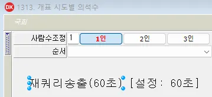
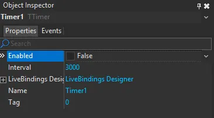

대망의 2025년, 우리는 선거방송 시스템을 리빌드하기로 결심했다.
사실 단순히 리뉴얼이 아니라 ‘이제 진짜 더는 못하겠다’라는 외침으로 시작되었다.

우리가 사용하는 선거방송 클라이언트는 델파이(Delphi)로 개발되어있다.
처음 이 시스템이 만들어진 건 약 20년전으로, 대규모 프로젝트로 구축된 결과물이었다. (당시에는 엄청난 프로젝트)
그런데 놀랍게도 아직도 현역이다.

그 사이 윈도우는 3번 바뀌고, VSCode는 AI를 품었고, 자바스크립트는 프레임워크가 15개는 나왔는데.. 우리는 여전히 델파이를 켜고 있었다.(버전도 그대로)

처음 델파이로 프로젝트 소스를 봤을 때 든 생각은

> 이걸 사람이 했다고?


함수, 프로시저, 이벤트 핸들러, 폼 단위의 변수, 온갖 캡션과 타이머 속성.
C++도 아니고, C#도 아닌 것이, 파스칼 문법 기반에 UI 바인딩이 붙은 그 무언가…

무려 20년 동안 이걸로 클라이언트를 개발하고 실시간으로 생방송을 돌려왔다.

우리 영보이들이 느끼기에 하나의 선거 프로젝트는 하나의 우주와 같았다.
단일 프로젝트에 수십개의 폼, 각 폼 안에는 수백의 컴포넌트와 이벤트, 그리고 클래스안에 이유를 알 수 없는 필드와 메서드..

```delphi
unit example;

interface

uses
  Windows, Messages, SysUtils, Classes, Graphics, Controls, Forms, Dialogs,
  StdCtrls, Buttons, ExtCtrls, Db, FireDAC.Comp.Client,
  Grids, DBGrids, ComCtrls, Math, Mask, Menus, ActnList, Spin,
  DBCtrls, DBCGrids, DBClient,
  UnitDll, FoldPanel, UnitComp_LogToFile,
  TMAXLIB, sbsele_fdl_utf8,
  bGlobal, bConstDef, bMsgDef, bFunDef, bFunProtocol, bFunCode,
  SEConst, SEComm, SECommEx, SERegistry, SECommQr2, SESwitchButton, SEComboBox, SEBitBtn,
  SEDBCtrlGrid, seClientDataSet, SEDBText, SELabelCommTypes,
  seLabelAutoReQueryNSend,
  System.Json, System.Actions;

type
  TFormA001 = class(TFormTop)
    btnA01: TBitBtn;
    dsA01: TDataSource;
    btnA02: TBitBtnSE;
    btnA03: TBitBtnSE;
    pnlA01: TPanel;
    swtA01: TSwitchButton;
    btnA04: TBitBtnSE;
    btnA05: TBitBtnSE;
    cboA01: TComboBoxSE;
    pnlA02: TPanel;
    cdsA01: TSBSClientDataSet;
    ctrlGridA01: TSEDBCtrlGrid;
    txtA01: TSEDBText;
    txtA02: TSEDBText;
    txtA03: TSEDBText;
    txtA04: TSEDBText;
    txtA05: TSEDBText;
    txtA06: TSEDBText;
    txtA07: TSEDBText;
    txtA08: TSEDBText;
    txtA09: TSEDBText;
    txtA10: TSEDBText;
    txtA11: TSEDBText;
    txtA12: TSEDBText;
    txtA13: TSEDBText;
    txtA14: TSEDBText;
    txtA15: TSEDBText;
    txtA16: TSEDBText;

    lblA01: TLabel;
    lblA02: TLabel;
    lblA03: TLabel;
    lblA04: TLabel;
    lblA05: TLabel;
    lblA06: TLabel;
    lblA07: TLabel;
    lblA08: TLabel;
    lblA09: TLabel;
    lblA10: TLabel;
    lblA11: TLabel;
    lblA12: TLabel;
    lblA13: TLabel;
    lblA14: TLabel;
    lblA15: TLabel;

    procedure actA01Execute(Sender: TObject);
    procedure listA01DblClick(Sender: TObject);
    procedure evtA01Changed(Sender: TObject);
    procedure actA02Click(Sender: TObject);

  private
    procedure SetViewA01(abViewMode: boolean); override;
  public
    procedure ProcA01(abResetCode: boolean = True); override;
    function ProcA02(var asService: AnsiString; abNoButtonSetting: boolean = False): boolean; override;
    procedure ProcA03(abResult: boolean); override;
    function ProcA04(var asService: AnsiString; abOnAirMode: boolean = False): boolean; override;
    procedure ProcA05(abResult: boolean); override;
    function RetrieveA01(apData: pointer; aiRowCnt: integer = 1; abTotal: boolean = False): integer; override;
  end;
  
  /* 아래 implementation은 여러분의 정신 건강을 위해 보여드리지 않음 */
```

문제는 이게 어떤 흐름으로 연결되어 있는지를 아무도 모른다는 점이다.
정확히는 문서가 없어서 직접 따라가면서 배워야한다.

조회 버튼을 눌러서 서버에서 데이터를 가져오는 부분을 찾고 싶은데, Retrieve 이름을 보고 함수를 찾아갔지만 종종 함정에 빠지곤 했다. 그냥 Break Point를 잡고 Debug를 하면서 본인이 직접 소스코드와 혼연일체가 되는것이 제일 빠르다.

혹자는 궁금할 수 있다.


**Q. 그래도 최소한의 개발 가이드나 문서는 있지 않나요?**

**A. 없습니다.**


정확히 말하면 “과거에 있었을지도 모르는 문서가 있었던 적이 있었을 수도 있는 가능성”(?)은 있습니다.
(나는 델파이를 배운적도, 뭔지도 모르고 바로 프로젝트에 투입되었다 ^^)

개발 문서의 부재로 그 결과 새로운 선거를 준비할 때 마다 우리는 기존 소스를 그대로 복사해서 수정했다.

20XX_총선 → 20XX_지선 → 20XX_대선.


**소스코드도 선거처럼 순환되었다.**


문제는 이것이 단순 소스 복사가 아니라 수정할수록 쌓이는 ’수정의 흔적’들이 코드 곳곳에 마치 화석처럼 남아있는점이다. 거기에다가 임시 예외처리, 임시 데이터, 임시 테스트 코드까지 합쳐진다면…?

사실상 과거의 나 자신뿐만 아니라, 그보다 더 과거의 누군가와의 싸움이 되기도 한다.

---
델파이에서 겪은 가장 미스테리한 공포 중 하나는 바로 히든 프로퍼티다.
화면의 어떤 동작을 바꾸고 싶은데 아무리 코드를 뒤져도 안 나오는 경우가 있었다.
예를 들어 아래 프로그램에서 타이머를 60초에서 30초로 바꾸고 싶은데.




소스코드에는 아무리 찾아도 아래와 같은 코드가 없었다.

```delphi
Interval := 60000;
```

프로시저, 이벤트, 호출 트리 전부를 정말 하루종일 뒤졌는데 안 나왔다.
그러다 김차장님과 몇 시간 뒤에 발견한 진실은… 스토리보드 속성이었다.



델파이의 폼 디자이너에는 코드에 드러나지 않은 프로퍼티가 엄청 많았고, 속성창을 하나하나 열어봐야


```
Enabled := False, Interval := 5000
```

같은 코드와 값을 찾을 수 있고, 이것이 UI 동작을 바꾸는 핵심 요소일때도 너무 많다.

“왜 안되는거지… 도대체 어디서 바꾸지…?”라고 나 자신을 자책한적도 많았지만, 몇번이나 선거를 한 선배들도 항상 까먹으셨다.

아래는 실제로 델파이에서 사용한 데이터 처리코드로, 티맥스 서버가 보내준 데이터를 ClientDataSet1에 세팅한다.


```
with ClientDataSet1 do
  try
    DisableControls;
    ... (중략)
    for j := 0 to iHUBO_MIN_CNT - 1 do
    begin
      OPENRATE = EQGetVal (ClientDataSet1, 'SO_OPENRATE');
      EQSetVal(ClientDataSet1, 'OPENRATE', OPENRATE);
      iHuboNum := iHuboNum + 1;
    end;
    ...
  finally
    EnableControls;
    if abTotal then First;
  end;
```


내가 처음 이 코드를 보았을 때, 정말로 무엇을 하는건지 직관적으로 이해하기 어려웠다.

1. 데이터 형식이 JSON이나 XML이 아니다
* FDL이라는 티맥스 전용 포맷으로, 데이터가 순차적으로(순서대로) 보내진다.
* 그러므로 클라이언트에서 데이터를 순서 기반으로 꺼내야한다.
* 인덱스를 하나라도 틀리면 전/후 데이터가 꺼내진다.
2. 데이터 매핑이 어렵다
* EQGetVal, EQSetVal, _SetValExArray 같은 함수를 반복적으로 호출하고, 그 안에서 무슨 일이 벌어지는지는 디버깅해서 알아내야 한다.
3. 변수명은 대부분 약어 + 숫자
* iHuboNum, TH_SEQ, F_SUNCODE, u_Seq… 등 의미를 유추하기 힘든 변수가 많다.

결국에 돌아오는 선거마다 우리가 할 수 있는 건 과거 프로젝트를 복사하고 기도했다.

> “이번에는 후보가 6명이네” → 지난 소스 복사해서 후보수 수정
> 
> “이번에는 득표율 대신 득표수를 보여주자” → 지난 소스 복사해서 득표율 필드를 득표수로 변경

위와 같은 방식으로 매번 선거를 준비했고, 심지어 주석까지 복사된 소스에서 **Result1**, **Result2**과 같은 변수명으로 인해 소스를 이해하는데만 며칠이 걸렸다.

---
“C언어로 서버를 개발한다”라는 말을 들으면 얼핏 빠르고 성능이 좋은 시스템을 기대하게 된다. 하지만 우리의 현실은 `tpreturn`, `fballoc`, `fbput`, `EXEC SQL DECLARE` 코드들이 난무하는 2000년대 느낌을 물씬 풍기는 티맥스 서비스다.

선거방송 프로젝트의 백엔드는 티맥스 기반으로 개발되어 있었고, 놀라운 건 델파이와 마찬가지로 20년 전 이 시스템을 한번 구축한 후 그대로 지금까지 이어받아서 매 선거마다 개발을 해왔다는 점이다.


```
int x1(TPSVCINFO *x2)
{
    FBUF *x3;
    FBUF *x4;        
    COMM_HD *x5;
    
    x5 = (COMM_HD *)malloc(sizeof(COMM_HD));    
    memset(x5, 0x00, sizeof(COMM_HD));
    
    x4 = (FBUF *)x2->data;

    F_A1(x2, x4, x5, logfile);    
      
    if (!F_B1(x4, x5))
    {
        tpreturn(TPFAIL, -100, NULL, 0, 0);    
    }

    x3 = fballoc(MAX_COUNT, MAX_BUFF);            
    if (x3 == NULL)
    {
        LogPrint(logfile, "ERR01: send buffer alloc fail\n");
        free(x5);
        tpreturn(TPFAIL, -1, NULL, 0, 0);    
    } 
          
    int x6 = F_C1(x4, x3, x5);    
    
    F_A2(x3, x6, x5, logfile);
}
```


* TPSVINFO, FBUF, COMM_BF는 모두 티맥스 전용 구조체
* 비즈니스 로직은 하나의 함수 안에서 FDL 파싱 → DB 커서 → fbput → 데이터 전송을 한꺼번에 진행
* 필드명은 줄임말 + 대문자 + 숫자로 구성된 암호


티맥스는 자체적으로 FDL(Field Definition Language)라는 포맷을 사용한다.
```
FB_GET(rcvbuf, MENU_ID, h_menu_id, 0);
fbput(sndbuf, SO_GIHO, (char *)szgiho, 0);

```
`fbput`은 데이터를 실어서 보내고, `fbget`은 데이터를 꺼낸다.

처음에는 간단해 보이지만 실제로는

* FDL 필드명이 어디서 정의되어있는지 찾기 어려움
* FDL 필드 타입을 추적하려면 FDL 정의서를 일일이 찾아야 함
* 에러가 나도 어디서 났는지 알기가 어렵다

---
당신은 커서를 써보셨나요? 지금 유행하는 AI 에디터 Cursor 아닙니다.

티맥스에서는 데이터베이스 접근도 일반적인 ORM이 아니라 **Embedded SQL Cursor** 방식을 사용한다

```
EXEC SQL DECLARE CURS_E2000C CURSOR FOR
  SELECT A.* FROM E24.TBL A ...
```
실제로 SELECT 쿼리를 하나 가져오는데도
```
EXEC SQL OPEN
EXEC SQL FETCH
EXEC SQL CLOSE
```
위의 3단계를 직접 사용해야한다.

예를 들어, 후보자 테이블에서 특정 지역의 후보 목록을 조회하는 코드를 개발한다면 아래와 같다.

```
/* 커서 선언 */
EXEC SQL DECLARE CUR_HUBO CURSOR FOR
  SELECT HUBO_ID, HUBO_NM, DANG_CD
    FROM E24.HUBO_TBL
   WHERE SIDO_CD = :sidoCd;

/* 커서 오픈 */
EXEC SQL OPEN CUR_HUBO;

/* 반복문을 통해 후보자 정보 하나씩 FETCH */
while (1)
{
    EXEC SQL FETCH CUR_HUBO INTO :huboId, :huboNm, :dangCd;

    if (sqlca.sqlcode != 0)  // 더 이상 가져올 데이터가 없으면 종료
        break;

    // 가져온 데이터를 사용한 로직 처리...
}

/* 커서 닫기 */
EXEC SQL CLOSE CUR_HUBO;
```


그런데 선거방송에서는 후보자 데이터를 화면에 보여줄 때 정렬 기준이 다양하다.

1. 기호순 정렬
2. 득표순 정렬
3. 출구조사 순위


다만, 이걸 단순히 SQL ORDER BY로 해결할 수가 없다.
이미 Cursor로 구조체에 데이터를 담고, 후보 정렬은 배열을 다시 정렬해야만 한다.

```
/* 
  _tmpC: 화면에 출력할 후보 수 
  _onair.stRank: 후보 출력 순서가 담긴 문자열 배열 (ex: "3", "1", "2"...)
  _rk: 해당 순위에 해당하는 후보 인덱스 (정수로 변환)
*/

/* 순위 배열에서 순차적으로 후보 데이터를 조회하고 조건을 만족하는 후보만 처리 */
for (int _iX = 0; _iX < _tmpC; _iX++)
{
    /* szR은 현재 순위 문자열을 저장하는 변수, _rk는 이를 정수로 변환한 순위 값 */
    strcpy(_szR, _onair.stRank[_iX + 1]);
    _rk = atoi(_szR); 

    /* giho (기호) 정보가 'Y'인 경우만 유효 후보로 간주 */
    if (_theme.gihoInfo[_rk - 1] == 'Y') 
    {
        /* 후보 기호를 송신 버퍼에 저장 */
        fbput(_snd, GIHO_ID, (char *)_szR, 0);

        /* 정당 코드, 후보 이름 등 기본 정보 저장 */
        fbput(_snd, DANG_CD, (char *)data[_rk].dangcode, 0);
        fbput(_snd, HUBO_NM, (char *)data[_rk].huboname, 0);

        /* 득표 수, 득표율, 득표순위 등 선거 통계 정보 저장 */
        fbput(_snd, CNT, (char *)&data[_rk].cnt, 0);
        fbput(_snd, RATE, (char *)&data[_rk].rate, 0);
        fbput(_snd, RANK, (char *)&data[_rk].rank, 0);


        /* 처리된 후보 수가 최소 처리 대상 수를 만족하면 반복 종료 */
        if (_cntDone >= _minCnt)
            break;
    }
}
```

이 복잡한 시스템을 매 선거마다 새로운 컨셉에 맞게 뜯어 고치고, 방송 당일 몇시간 전까지도 수정해서 투입했다. 하지만 우리는 매번 데이터를 바이폰에 성공적으로 전달했고, 방송을 성공적으로 해냈다.

그리고 매번 그만큼 시스템은 망가졌다.
그래서 이제는 진짜 바꾸려고 했다.
