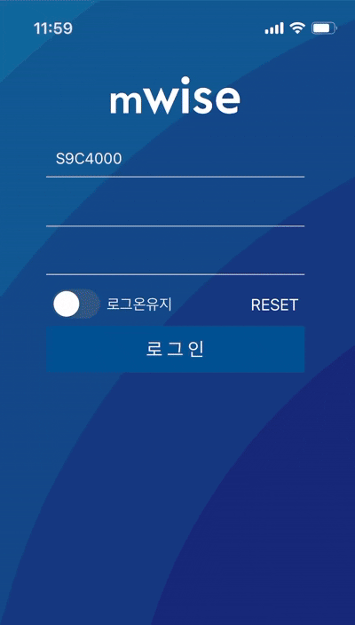

2015년 즈음, 모바일이 단순한 트렌드를 넘어 생활의 중심이 되어가던 시기였다.

대학생이던 나도 지하철, 버스, 점심 주문, 은행 업무를 모바일로 처리하고 있었고 우리팀도 모바일 전환을 목표로 했다고 한다.

당시에 “모바일이 안 되면 감각이 떨어진다”라는 분위기도 있었다고 한다.

이미 회사 내부에 WiSE라는 사내 시스템이 있었고, 업무 프로세스와 권한, 데이터 흐름이 그 안에서 이루어지고 있었다.
하지만 정작 그 WiSE는 데스크톱 중심, 브라우저 기반이었고 모바일 경험은 뒷전이었다.

“이제 WiSE도 모바일이 되어야 하지 않겠나?”라는 사장님의 혜안(慧眼)에 그렇게 우리팀은 mWiSE라는 이름으로 모바일 앱 개발을 시작했다.

모바일 + WiSE의 결합은 도전적이었고 동시에 불안했다고 한다.

---
돌이켜보면 2015년 당시 우리팀의 구성은 백엔드 개발자와 DB 개발자가 대부분이었다.
네이티브 앱을 개발해본 사람은 한명도 없었다.
그런데 앱을 개발하라고 하니 얼마나 당황했을까?

그렇데 대부분의 선배들은 프로젝트를 두려워 했을 것이고, 내가 존경하는 이국장님께서 프로젝트에 자원해서 뛰어들었다고 한다.

상상하기 어렵지만, 이국장님께서는 프로젝트가 시작되자마자 코틀린과 스위프트 책을 독학으로 독파하시면서, 프로젝트를 이끌어가셨다고 한다.

하지만 문제는 분명했다. 모바일 네이티브 역량이 없었다.
게다가 설계 경험, UI 경험, OS 경험 등 솔직히 모든 부분이 부족했다.

역량이 받쳐주지 않으니, 팀은 빠르게 현실 타협을 모색했다.
“웹 기술은 우리가 하고 있으니, 그걸 최대한 써보자. 인적 구성으로 웹은 가능하니까” 라고 결론이 나왔다.

그 결과 네이티브 앱은 껍데기 역할만 하는걸로.
사용자에게 앱이라는 외형을 주되, 실제 내부 기능은 웹으로 처리하자는 전략이었다.

이 결정을 내린 순간, mWiSE는 90% 이상 웹앱이었다.
로그인, 업무 메뉴, 조회 등 모든것을 웹으로 개발하고 앱은 그냥 감싸는 툴 정도의 구조로 계획이 잡혔다. 하지만 단순해보여도 유지보수, 성능 등에서 걱정이 되는 부분은 많았다고 한다.

가장 큰 실수라면 **로그인 방식**이었다.
당시 우리는 웹뷰(WebView)에 대한 자신감이 없었다고 한다. “웹뷰 렌더링이 이상하게 보이지 않을까?”, “보안 이슈는 없을까?”
이런 마음이 복잡하게 작용했고, 개발 리스크를 낮추기 위한 방어적인 선택이 나왔다.

그 결과 앱에서 로그인 버튼을 누르면 외부 브라우저 창으로 이동하는 구조가 되었다.
네이티브에 앱에서 로그인을 하면, 웹 브라우저(사파리, 크롬…)으로 이동하고 거기서 웹이 시작한다.

하지만 사용자 입장에서 보면 대체 이게 무슨 경험인가?

`앱 → 로그인 → 브라우저 → (로그아웃 → 앱 → 로그인) → 브라우저`

사이사이의 UX 단절이 엄청 컸다. 게다가 브라우저마다 UI가 조금씩 다르고, 비동기 이슈도 있었다.

그리고 이건 내가 2025년의 관점에서 바라봤을때, 가장 심각한 유저 경험이었다.

국장님, 부장님과 같은 선배들이 mWiSE에서 이상한 문제가 생겼을 때 우리팀에 와서 본인의 폰을 보여주신다.
그런데 화면을 보니 브라우저 탭이 99개가 있었다. 브라우저 앱이 온통 탭, 다른 탭, 또 탭…
“아니… 로그인만 했는데 왜 갑자기 탭이 30개야?”, “이 탭 닫아도 되는 거니?” 와 같은 질문을 하신다.

이런 경험 하나하나가 UX 붕괴를 증명하는 증거라고 생각한다.

사용자는 당황한다. “이거 왜 이래?”

팀은 골치아프다. “왜 막 열리지?”

운영 부서는 욕을 한다. “우리 시스템 왜 이래?”

---
아마 처음에는 “앱 하나라도 있으니 괜찮다”라는 느낌이 있었을지도 모른다.
하지만 프로덕션을 운영중인 앱은 **살아 움직이는 유기체**다.
OS 버전이 업데이트되고, 기기들의 스펙이 바뀌고, 보안 규정도 바뀌며, 사실 이 모든것을 계속 대응해야한다.

하지만 우리의 구조는 이미 불안정한 기반 위에 세워졌고, 네이티브 쪽 기능 확장이 거의 불가능했다. 또한 웹 중심 구조도 단순 변화 대응이 어렵게 꼬여 있었다.

시간이 흐르면서 “**이곳 하나 수정하려면 이 기능도 고치고, 저것도 뒤따라 고치고…**”, “**업데이트하면 뭔가 항상 문제가 생기네**”, “**이 모듈은 왜 이렇게 얽혀있지?**”
이런 사소한 고통들이 누적되었고, 결국 10년이 흐르자 mWiSE는 무거운 짐이 되어있었다.

팀 내에서는 차세대 mWiSE 프로젝트의 필요성은 이미 대두되었다.
이 프로젝트를 “누가 책임지고 할래?”라는 논의가 필요했지만, 이미 분위기는 나로 결정되었다. 물론 내가 모바일 개발 경험이 있기도 했고, mWiSE에 대한 의견을 가장 많이 내기도 했다.

2025년 상반기에는 대통령 선거 방송 시스템 구축으로 정신이 없었고, 하반기부터는 아예 차세대 mWiSE 프로젝트가 시작되어 정신없이 하루하루를 보내고 있다.

어쩌면 운명이 아닐까 싶다. mWiSE를 제로에서 다시 만드는 사람이라니.
부담은 크지만, 기회도 크다.

단순히 “앱을 다시 만드는 것”을 목표로 삼지 않고, 6개월의 제한된 시간에서 새로운 mWiSE가 갖춰야 할 것을 정리했다.

* 완전한 앱 경험

로그인을 포함하여 모든 흐름이 앱 안에서 이루어져야한다.(외부 브라우저 그만)

* 모듈화와 확장성

기능을 독립적으로 관리하고, 수정/추가가 쉽도록한다

* 네이티브 기능 활용

푸시 알림, 캐시, 백그라운드 활용 등 앱의 기능을 활용한다

* 기술 부채 청산

과거의 꼬여있는 코드를 정리하고 청산한다(특히 jQuery, WebSquare)

**SBS의 새로운 플랫폼의 탄생**이라는 마음 가짐으로, 이 프로젝트에 임해보고자 한다.
