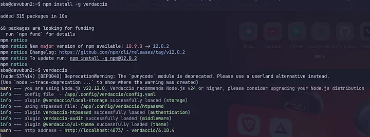
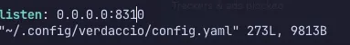
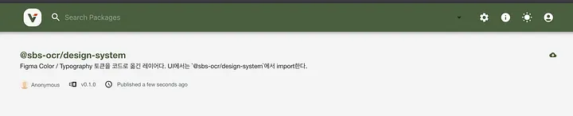
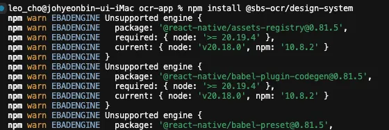
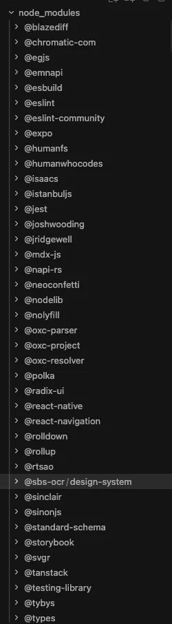

> “이 버튼 컬러값 또 바뀌었나요?”

여러 프로젝트를 한꺼번에 진행하다 보면 어느 순간 반드시 맞닥뜨리는 거대한 벽이 있다. 바로 ’**디자인 시스템의 파편화**’다.

초기에는 서비스마다 컴포넌트나 디자인 토큰(Color, Typography 등)을 빠르게 복사해서 붙여넣는 방식으로 개발을 진행했다. 당장은 편했고 개발 속도도 빠른 듯했다. 하지만 프로젝트 수가 3개, 4개로 늘어나고 시간이 흐르면서 유지보수의 재앙이 시작되었다.

“*A 프로젝트는 메인 컬러가 #0055FF인데, B 프로젝트는 왜 #0044DD죠?*”

“*Figma 디자인 가이드 업데이트된 거 어떤 프로젝트까지 반영되었나요?*”

-모 디자이너 -

각 프로젝트마다 컴포넌트 코드가 제각각 수정되었고, 디자인 가이드가 변경될 때마다 모든 프로젝트의 소스코드를 일일이 뒤져가며 수동으로 수정해야 했다. 전형적인 ‘복사-붙여넣기식’ 개발이 만들어낸 서글픈 기술 부채였다.

이 문제를 근본적으로 해결하려면 **디자인 시스템을 단일 레포지토리로 분리**하고, **npm 패키지로 공통 관리**하는 구조가 필수적이었다. 하지만 회사의 고유 디자인 토큰과 UI 자산을 외부 공개 npm 레지스트리(npmjs.com)에 올릴 수는 없는 노릇이었다.(올리려고 했는데 실패함 😋)

결국 우리의 결론은 ”**사내 프라이빗 npm 레지스트리를 직접 구축하자**”였다.

---

**1. Verdaccio로 사내 npm 프라이빗 레지스트리 세팅하기**

사내 프라이빗 패키지 저장소를 구축하기 위해 선택한 도구는 [Verdaccio](https://www.verdaccio.org/)였다. 경량화되어 있으면서도 Node.js 환경에서 손쉽게 구축할 수 있고, 패키지 검색 UI까지 기본 제공하기 때문에 사내 인프라용으로 제격이었다.

먼저 사내 개발 서버에 접속하여 Verdaccio를 전역으로 설치하고 실행했다.

실행하자마자 Node.js 버전 관련 경고(v22.12.0 환경에서 v24이상 권장)와 함께 설정 파일(config.yaml), 인증 파일(htpasswd), 로컬 저장소 플러그인이 차례로 로드되었다. 기본 상태에서는 http://localhost:4873/ 으로 실행된다.

하지만 사내 다른 개발자들의 컴퓨터에서도 이 레지스트리에 접근하고 패키지를 설치하려면 외부 접속(External Binding) 설정이 필요했다. 설정 파일(~/.config/verdaccio/config.yaml)을 열어 포트 바인딩을 수정해 주었다.

기존 기본 포트(4873) 대신 사내 내부 규칙에 맞춰 8310(예시) 포트로 바인딩을 변경하였고, 이로써 사내망 어디서든 *http://<서버IP>:8310* 으로 접속할 수 있는 사내 전용 npm 패키지 저장소가 완성되었다

**2. 프로젝트의 디자인 시스템을 @sbs-ocr/design-system으로 패키지화**

레지스트리가 준비되었으니, 이제 프로젝트별로 흩어져 있던 Figma Color와 Typography 토큰을 코드로 옮겨 담은 공통 패키지를 제작할 차례였다.

패키지 이름은 **@sbs-ocr/design-system**으로 명명했다.
(이번 사내 OCR 프로젝트의 디자인 시스템을 먼저 옮겨보기로 결정함)

Figma에 정의된 디자인 토큰들을 코드 레이어로 정밀하게 옮기고, 프로젝트에서는 이 패키지에서 직관적으로 import하여 사용하도록 구조를 세웠다.

빌드 완료 후 사내 Verdaccio 레지스트리로 첫 배포(npm publish)를 진행했다.

Verdaccio 웹 대시보드에 접속하니 우리가 만든 *@sbs-ocr/design-system v0.1.0* 패키지가 깔끔하게 등록되어 있었다.

> @sbs-ocr/design-system
> “Figma Color / Typography 토큰을 코드로 옮긴 레이어다. UI에서는 @sbs-ocr/design-system에서 import한다.”

더 이상 소스코드를 복사-붙여넣기할 필요 없이, 단 한 줄의 설치 명령어로 프로젝트별 최신 디자인 시스템을 받아올 수 있는 기틀이 마련된 순간이었다.

**3. 프로젝트 연동과 현실의 벽 (트러블슈팅)**

이론상으로는 모든 게 완벽해 보였다. 하지만 늘 그렇듯 실제 애플리케이션 프로젝트에 적용하는 순간 ‘현실의 문제’들과 직면하게 된다.

실제 서비스를 담당하는 앱 프로젝트(ocr-app)로 이동하여 사내 패키지 설치를 시도했다.

명령어를 실행하자마자 터미널에 *EBADENGINE* 경고 레이아웃이 주르륵 도배되기 시작했다. React Native 관련 의존성 패키지들(*@react-native/assets-registry*, *@react-native/babel-plugin-codegen* 등)이 요구하는 Node.js 버전(>= 20.19.4)과 현재 개발 장비의 Node.js 버전(v20.18.0) 사이의 불일치 문제였다.

다행히 엔진 충돌 경고(Warning)일 뿐 설치 자체는 정상 진행되었다. (Node 버전 정리는 다음 스프린트 과제로 조용히 메모장에 적어두었다…)

설치가 완료된 후 *node_modules* 디렉토리를 열어 설치 상태를 최종 점검했다.

VSCode에서 *@sbs-ocr/design-system* 폴더가 보란 듯이 자리 잡은 모습을 확인한 후 디자인 시스템 야호~!

**4. 구축 후 변화와 느낀점**

사내 npm 프라이빗 레지스트리와 프로젝트 별 디자인 시스템 패키지를 구축한 이후, 우리 팀의 개발 문화에는 몇 가지 중요한 변화가 생겼다.

1. 디자인 파편화의 종식

이제 Figma에서 컬러 스펙이나 타이포그래피 규칙이 바뀌면, 패키지 하나만 업데이트하고 버전만 올려 배포한다. 각 프로젝트에서는 *npm update @sbs-ocr/design-system* 한 줄로 동일한 최신 디자인 시스템을 일관되게 유지할 수 있게 되었다.

2. 복사-붙여넣기 코드 유산 청산

프로젝트를 신규 생성할 때 과거 소스코드를 통째로 복사해오던 익숙하지만 위험했던 습관을 끊어낼 수 있었다.

3. 사내 모듈화 생태계 기틀 마련

이번 디자인 시스템 구축을 시작으로, 사내 공통 유틸리티나 API 통신 모듈 등도 *Verdaccio*를 통해 패키지화하여 공유할 수 있는 자산이 되었다.

기술 선택과 인프라 구축은 결국 ”현실의 불편함을 극복하고 팀 전체의 생산성을 높이기 위한 싸움”이다. 거창하고 화려한 기술 프레임워크를 도입하는 것보다, 파편화된 코드를 하나로 모으고 팀원들이 안심하고 개발할 수 있는 환경을 만드는 것이 이번 프로젝트에서 느낀 참된 보람이다.
(2년 동안 얘기했는데 결국 내가 함… 😅)
